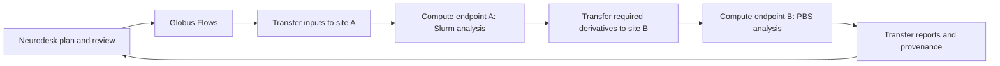

# Globus pipelines assessment

This is a design proposal based on repository documentation and upstream
documentation reviewed on 16 October 2026. No Globus account, endpoint, transfer,
or HPC analysis was exercised.

## Recommendation

Use Neurodesk to author, review, and inspect analyses; use Globus Flows to
coordinate transfers and execution across configured HPC sites. Flows already
supports waiting for a Transfer action before invoking a Compute function.
[Globus flow authoring](https://docs.globus.org/api/flows/authoring-flows/)

Build on the existing [ASTRA integration](../architecture/astra.md) for scientific
intent and observed provenance. Add a separate execution manifest identifying
the approved plan revision, inputs, pinned software, parameters, site assignments,
resource requests, and output destinations. ASTRA validation alone does not
establish executable correctness or prove which software ran.

This would be an alternative orchestration backend to the proposed
[distributed compute broker](distributed-compute-broker.md), not current runtime
behavior. That historical design explicitly excludes Globus from its self-hosted
core and permits an institutional exception. Adopting Globus means accepting its
hosted services and institutional data-management requirements.

## Proposed user workflow

1. Draft an analysis in JupyterLab or T3, with an agent optionally helping to
   produce the ASTRA specification and scripts.
2. Review a concrete run manifest showing data movement, software versions,
   target sites, requested resources, and expected outputs.
3. Validate access and site configuration, then submit an immutable run to Flows.
4. Follow transfers, queued jobs, running analyses, and output validation from
   Neurodesk. Reopening the desktop reconnects to the saved run identifier.
5. Open returned reports and provenance in Neurodesk. Keep bulk derivatives at
   the selected storage destination unless the user requests them locally.

This is a proposed sequence. Flows owns orchestration outside the desktop
session; each site's scheduler owns allocation and execution. Prefer sites
already holding the data. Split work across sites when capabilities or access
justify the transfer. Keep fine-grained analysis dependencies within the chosen
pipeline engine or scripts.

## Site integration

Each site needs a storage collection, a Compute endpoint, authorized local
accounts and allocations, and a tested software environment. Official Compute
examples include Slurm, PBS Pro, and Slurm with Apptainer. A default
`LocalProvider` executes on the endpoint host, so production configuration must
explicitly select the batch scheduler.
[Endpoint examples](https://globus-compute.readthedocs.io/en/latest/endpoints/endpoint_examples.html),
[endpoint configuration](https://globus-compute.readthedocs.io/en/latest/endpoints/endpoints.html)

A storage collection UUID and a Compute endpoint UUID identify different
resources. Store their path mapping in a site profile: for example, collection
path `/project/run-42` might be `/scratch/project/run-42` on compute nodes.
Validate shared filesystem visibility and permissions before execution.
Stanford Research Computing's existing transfer/compute/return demonstration
explicitly handles this mapping and provides a useful reference.
[Stanford example](https://github.com/stanford-rc/globus-example-flow#parameters-and-customization)

For the pilot, run a small registered Python wrapper in a scheduler-provisioned
worker and have it invoke the pinned Neurodesk tool through the site's
Apptainer/Neurocommand installation. Return a compact output manifest after the
analysis exits and its outputs pass validation. Containerizing the Compute
worker itself is also supported, but that image must contain
`globus-compute-endpoint`; existing analysis images cannot be assumed to qualify.
[Container requirements](https://globus-compute.readthedocs.io/en/latest/endpoints/endpoints.html#containerized-environments)

For long native batch jobs, consider a site adapter with distinct submit,
status, and cancel operations. Flows can poll the returned scheduler job ID;
submission success must never count as analysis completion. Give every approved
step a stable identity, reconcile ambiguous submissions, and preserve completed
outputs on retry. This adapter and its cancellation behavior require development
and validation.

## Operational constraints

| Concern | Design consequence |
| --- | --- |
| Flow action timeout | Explicitly cover queue time and execution time. The default `WaitTime` is only 300 seconds. |
| Flow limits | Runs have a one-year maximum, state is limited to 200 KB, and run records are retained for up to 90 days. Archive provenance independently. |
| Compute payloads | Inputs and per-function results have 10 MB limits. Pass paths and manifests; use Transfer for images and derivatives. |
| Compute task lifetime | The documented inactivity threshold is two weeks; completed results not retrieved within 30 minutes can be abandoned. Persist outputs on site storage and verify long-job behavior. |

Sources: [action timeout](https://docs.globus.org/api/flows/authoring-flows/actions/),
[Flows limits](https://docs.globus.org/api/flows/limits/),
[Compute limits](https://globus-compute.readthedocs.io/en/latest/limits.html).
Use the explicit limits page over the Flows overview's broader claim of
unrestricted run duration.

Core Compute endpoints and task submissions require authentication but no
subscription. Free Flows use is limited to one flow with a 30-day lifetime, so
plan institutional subscription coverage for a maintained deployment.
[Compute subscriptions](https://globus-compute.readthedocs.io/en/latest/subscriptions.html),
[Flows limits](https://docs.globus.org/api/flows/limits/)

A user-owned endpoint can support a pilot where site policy permits it.
Multi-user deployment needs administrators to configure local identity mapping
and resource policies. Endpoint hosts need outbound port 443 access to the
Compute API and messaging services.
[Endpoint ownership](https://globus-compute.readthedocs.io/en/latest/endpoints/endpoints.html#starting-the-endpoint),
[network prerequisites](https://globus-compute.readthedocs.io/en/latest/endpoints/installation.html#prerequisites)

## Authentication and data control

Use Globus Auth delegation under the submitting user's identity. Keep OAuth
credentials out of manifests, chat, browser responses, and logs; protect any
Neurodesk submission route with Jupyter authentication and XSRF. Surface renewed
consent as an actionable paused state. Globus documents consent/resume handling.
[Consent handling](https://docs.globus.org/api/flows/working-with-consents/)

Bulk files transfer directly between collections, but Globus accesses file
metadata. Flow inputs and Compute arguments/results also enter hosted services.
Send only necessary, deidentified metadata and use institution-approved high
assurance configurations where required. Restrict the service's registered
functions and argument schema at the endpoint.
[Transfer data handling](https://docs.globus.org/faq/transfer-sharing/),
[Compute security controls](https://globus-compute.readthedocs.io/en/latest/endpoints/security_posture.html)

## Pilot acceptance

Start with one site, one public or synthetic dataset, and one pinned tool.
Demonstrate transfer, scheduled execution, output verification, provenance, and
desktop reconnection. Run the same task at a second site, then connect the sites
with a transfer-dependent analysis. Test failed transfers, duplicate submissions,
lost endpoints, expired authorization, scheduler cancellation, and reruns that
preserve successful work. Confirm site policies,
subscription coverage, filesystem mappings, and worker/container compatibility
before promising production support.

Gladier can reduce flow-authoring and function-registration boilerplate, but is
optional. Keep the approved manifest and generated flow inspectable regardless
of the authoring library.
[Globus Compute's Gladier overview](https://globus-compute.readthedocs.io/en/latest/actionprovider.html#gladier)
